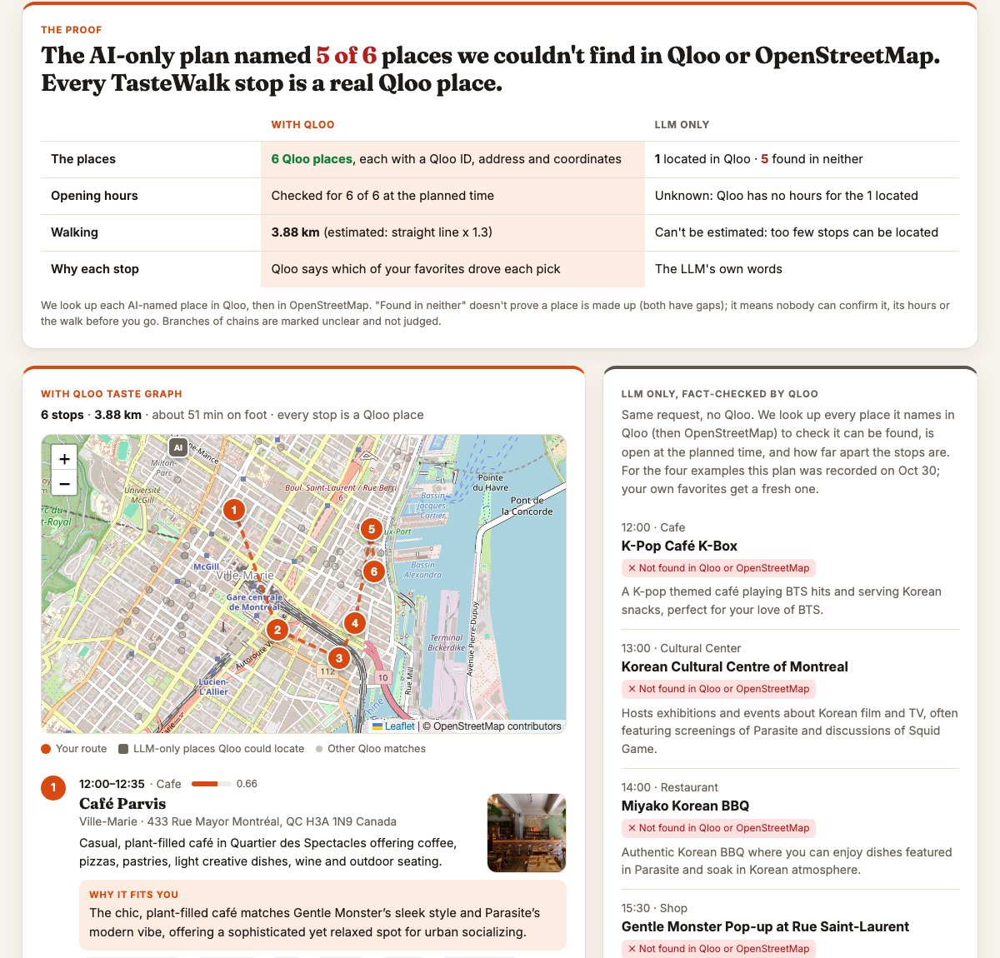
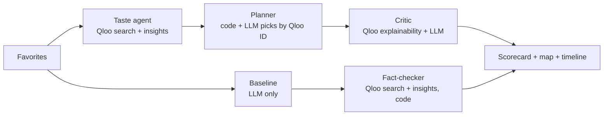

<div align="center">

# TasteWalk

### Tell it what you love. Get a walkable day built around your taste, not the tourist list.

Name a few favorites (artists, films, shows, games, brands). Qloo's taste graph finds the places in Vancouver that people with your taste love, agents plan a real walking day and explain every stop with the favorites that drove it, and a fact-checker shows what an AI alone would have told you instead.

**[Live demo](https://tastewalk-fy6u.onrender.com/?example=indie)** · **[Demo video](#demo-video)** · **[The proof](#the-proof)** · **[How it works](#how-it-works)**

[](#)
[](#what-makes-it-qloo-powered)
[](#how-it-works)
[](#the-proof)
[](LICENSE)

<sub>Built for the Qloo Agentic Hackathon 2026 · City: Vancouver · The demo runs on a free plan: if it was asleep, the first load can take about a minute.</sub>

</div>

---

## At a glance

| | |
|---|---|
| **18.4 km vs 3.1 km**: an AI-only "walking day" vs ours, for the same tastes. Qloo located all 6 of its places; the Orpheum is closed when you'd arrive | **7 of 24** places an AI alone named couldn't be found in Qloo or OpenStreetMap, across 4 example tastes |
| **Every stop is a Qloo place** with an ID, coordinates and hours where Qloo has them | **"Because you love X"** on every stop, from Qloo's explainability, not LLM guesswork |



<a id="demo-video"></a>**Demo video (1:41):** linked on the Devpost page (YouTube link added at submission).

## What it does
**Say, type or tap what you love:** speak a sentence ("I love Radiohead, Ghibli films and
Patagonia"), type it, or tap from 40+ favorites across music, film, TV, books, games, brands and
podcasts. The LLM only extracts the favorites you name; Qloo resolves each one. Then:
1. **Taste agent** resolves each favorite to a Qloo entity and asks Qloo for places in Vancouver
   that people with that taste love, for each part of the day.
2. **Planner agent** picks a varied day (one coffee, one meal, drinks last, no chains) by Qloo ID,
   orders it as a walk, schedules real times and swaps out places closed on arrival.
3. **Critic agent** explains each stop: Qloo's explainability says which of *your* favorites
   drove the pick, and the LLM turns that into a sentence.
4. **Baseline**: the same request goes to an LLM with no Qloo.
5. **Fact-checker** (code, no LLM) looks up every place the LLM named in Qloo, then in
   OpenStreetMap, and checks hours and walking for those it can locate.

## The proof
Four example profiles in Vancouver (Oct 30; the LLM-only plans are
[frozen](src/tastewalk/example_baselines.json) so the demo shows the same numbers), from
[docs/results/fact_check_examples.json](docs/results/fact_check_examples.json), which lists
every LLM-named place, its verdict and its walking legs.

**The clearest case (indie music & arthouse film):** Qloo located all 6 places the LLM named:
real, well-known spots. But the LLM's "walking day" is **18.4 km on foot, with 72-, 70- and
53-minute legs**, and the Orpheum is **closed** when you'd arrive. TasteWalk's day is 3.1 km and
no leg is over 15 minutes.

| Across the 4 examples | TasteWalk (Qloo) | LLM only |
|---|---|---|
| Can the place be found? | 24 of 24 Qloo places (by construction) | **11** in Qloo · **6** only on OpenStreetMap · **7 in neither** |
| Walking | 3.1-4.4 km per day, longest leg 20 min | indie: 18.4 km, longest leg 72 min; others can't be estimated for most stops |
| Open at the planned time | checked for 18 of 24 (where Qloo has hours), swaps out closed stops | 1 closed; most can't be checked |
| Why each stop | which of your favorites drove the pick (Qloo explainability) | the LLM's own words |

The first column is grounded by construction: that is the point. The question is what you get
without Qloo. "Found in neither" doesn't prove a place is invented (both sources have gaps; e.g.
The Roxy, a real club, wasn't found); it means nobody can confirm the place, its hours or the walk
before you go. Matching is strict on purpose (a wrong match would make false claims), so some real
places are missed. We dropped a taste-match comparison: Qloo's affinity for the LLM's located
places was similar to our picks, so it showed nothing.

## What makes it Qloo-powered
Every stop on the TasteWalk route comes from Qloo and carries a Qloo entity ID. The LLM can only
choose among Qloo's candidates by ID; anything else is dropped. Without Qloo there is nothing to
recommend, explain or fact-check.

| Step | Qloo API | What we use |
|---|---|---|
| Taste profile | `GET /search` (`types=urn:entity:artist`, `movie`, `brand`, ...) | entity resolution, tags |
| Candidates | `GET /v2/insights` with `filter.type=urn:entity:place`, `signal.interests.entities`, `filter.location=POINT(lon lat)` + radius, `filter.tags` per day slot | places with coordinates, hours, affinity |
| "Why it fits" | `feature.explainability=true` | share of each favorite in each recommendation |
| Vibe and category | place tags (ambience, setting, category) | chips, slots, filters |
| Fact-check | `GET /search` for each LLM-named place, then `GET /v2/insights` with `filter.results.entities` | locate and score another plan's places (OpenStreetMap as a second source) |

Verified API notes: [docs/research/01-qloo-api.md](docs/research/01-qloo-api.md).

## From request to result (one example)
The indie profile, step by step. IDs are shortened; Qloo response data is not stored in this repo
(Qloo's terms), so fields are described rather than pasted.

1. **Resolve each favorite:** `GET /search?query=Arcade Fire&types=urn:entity:artist&take=5`
   returns entities; we keep the first whose name matches the query (`entity_id` like `F4C7…`).
2. **Ask for places, one call per part of the day** (coffee, culture, shopping, food, drinks):
   ```
   GET /v2/insights
     filter.type=urn:entity:place
     signal.interests.entities=<Arcade Fire>,<Radiohead>,<Amélie>,<Lost in Translation>
     filter.location=POINT(-123.118 49.282)   filter.location.radius=4000
     filter.tags=urn:tag:category:place:record_store,urn:tag:category:place:book_store,...
     feature.explainability=true   take=15
   ```
   Each place comes back with `location.lat/lon`, `properties.hours`, `query.affinity`, tags
   (category, ambience) and `query.explainability["signal.interests.entities"]`: the share each
   favorite contributed. That share becomes the ♥ chips ("because you love Lost in Translation").
3. **Plan in code + LLM:** a compact walkable area, one coffee / meal / drinks stop, the LLM picks
   by Qloo ID only, code orders the walk, schedules times and swaps out stops closed on arrival.
4. **Fact-check the AI-only plan:** for each place the LLM named, `GET /search?types=urn:entity:place`
   (strict name match), then `GET /v2/insights?filter.type=urn:entity:place&filter.results.entities=<ids>`
   with the same favorites as signals; OpenStreetMap for names Qloo doesn't know; our routing code
   for hours and walking.

## Why it matters
- **Travelers** get a day picked by a "friend" who shares their taste, instead of the same top-10 list.
- **Locals** discover places in their own city that match what they already love.
- **Tourism boards and local businesses** get visitors spread beyond the usual hotspots, matched
  to independent places that suit them.

Research on AI-only trip plans keeps finding invented places, stops scheduled while closed and
stops far apart ([notes](docs/research/02-prior-art-and-risks.md)). TasteWalk grounds every stop
in Qloo and checks the route in code.

## How it works
Agents run in sequence and stream progress to the UI over Server-Sent Events:



- Distances, times, opening hours and route checks are computed in code, never by the LLM.
- The four example profiles use the code-only planner, so their routes stay identical across
  restarts and match this README and the video; the LLM still writes their explanations. Your
  own favorites get the LLM planner.
- LLM output is JSON validated with Pydantic, and retried with the error if invalid.
- If the LLM is unavailable (rate limit, outage), the Qloo route still ships with template text.
- Every Qloo and LLM response is cached on the server by request hash; the example profiles are
  warmed at startup. Qloo data is never committed (Qloo's hackathon terms).

## Quickstart
```bash
git clone https://github.com/atabak-eghbal/tastewalk && cd tastewalk
cp .env.example .env        # add QLOO_API_KEY and an LLM key (Groq free tier works)
uv sync
uv run python scripts/smoke_test_qloo.py          # check Qloo access
uv run uvicorn app.main:app --reload              # http://localhost:8000
```

Command line:
```bash
uv run python -m tastewalk.cli --fav "Arcade Fire:artist" --fav "Amélie:movie"
```

No keys yet? `TASTEWALK_FAKE_QLOO=1 uv run uvicorn app.main:app` runs the UI on fictional demo
places (a banner says so). Tests: `uv run pytest`.

The LLM is any OpenAI-compatible endpoint (`LLM_BASE_URL`, `LLM_API_KEY`, `LLM_MODEL`). The demo
uses Groq's free tier with `openai/gpt-oss-120b`.

## Deploy
The repo ships a `Dockerfile` and a `render.yaml` blueprint.
1. Render -> New -> Blueprint -> pick this repo.
2. Enter `QLOO_API_KEY` and `LLM_API_KEY` in the dashboard.
3. Open `/healthz`, then `/?example=indie`.

A GitHub Actions job pings `/healthz` every 10 minutes (set the repo variable `DEMO_URL`).

## Honest limitations
- **Vancouver only** in the demo; a city is a centre, radius, timezone and map box in code
  (Montreal is configured too).
- **Walking distance** is an estimate: straight-line distance x 1.3, not street routing.
- **Opening hours** are checked only when Qloo returns them (18 of the 24 example stops).
- **Time at each stop** uses simple per-category estimates.
- **Voice input** uses the browser's speech recognition (Chrome, Edge, Safari); elsewhere you
  type. "Read my day" uses the browser's built-in voice.
- **Qloo coverage**: some real places aren't in Qloo, so the fact-checker says "not in Qloo",
  never "doesn't exist". Name matching is strict on purpose and can miss a real match.
- **Results** are 4 profiles with one recorded LLM-only plan each; a fresh LLM plan differs
  from run to run (custom favorites always get a fresh one).
- **Sub-venues** the LLM names ("Vancouver Art Gallery – Japanese Art Exhibit") are credited to
  the venue if the venue is found; we don't check that the exhibit or stall exists.
- **Independent places**: a short list of chains (H&M, Starbucks...) is excluded by design;
  Qloo's popularity score couldn't separate chains from local favorites.
- **The LLM-only baseline** is a plain one-shot prompt; it isn't told the weekday, and is
  checked against today's hours.

## Repo map
- `src/tastewalk/` - agents: `taste_agent.py`, `planner.py`, `critic.py`, `baseline.py`,
  `fact_check.py`; clients: `qloo.py`, `llm.py`, `osm.py`; `routing.py`, `loop.py` (orchestration)
- `app/` - FastAPI + SSE server and the single-page UI
- `docs/` - architecture, research, results, Devpost draft
- `tests/` - pytest suite (no network; Qloo and the LLM are mocked)

## License
MIT - see [LICENSE](LICENSE).
