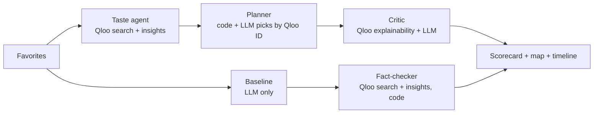

<h1 align="center">TasteWalk</h1>
<p align="center"><b>Tell it what you love. Get a walkable day built around your taste, not the tourist list.<br>Then watch Qloo fact-check what an AI alone would have told you.</b></p>

<p align="center">
  <a href="https://tastewalk-fy6u.onrender.com/?example=indie"><b>Live demo</b></a> ·
  <a href="#the-proof">The proof</a> ·
  <a href="#how-it-works">How it works</a> ·
  <a href="docs/architecture.md">Architecture</a>
</p>

Built for the **Qloo Agentic Hackathon 2026**. First city: Montreal.

> The demo runs on a free plan: if it was asleep, the first load can take about a minute.


## What it does
You enter a few favorites (artists, films, shows, books, brands). Five agents then:
1. **Profile** your taste: each favorite is resolved to a Qloo entity.
2. **Find** places in Montreal that people with that taste love, for each part of the day.
3. **Plan** a realistic walk: one walkable area, a day rhythm, real times, closed places swapped out.
4. **Explain** each stop: Qloo's explainability says which of *your* favorites drove the pick.
5. **Fact-check** an LLM-only plan for the same request: Qloo looks up every place the LLM named.

## The proof
Four example profiles, one run each (Oct 30), from
[docs/results/fact_check_examples.json](docs/results/fact_check_examples.json):

| | With Qloo | LLM only |
|---|---|---|
| Stops Qloo can verify (place, coordinates, Qloo ID) | **24 of 24** | **4 of 24** |
| Opening hours checked at the planned time | 24 of 24 | only the 4 located |
| Walking distance | measured, 2.8-4.8 km per day | can't be measured for most stops |
| Taste match (Qloo affinity, where comparable) | higher in 3 of 3 | lower |

"Not in Qloo" doesn't prove a place is invented: Qloo's coverage isn't complete. It means nobody
can confirm the place, its hours or the walk before you go. The taste-match gap is small
(e.g. 0.79 vs 0.78 for the indie profile); the large gaps are verifiability, hours and walking.

## What makes it Qloo-powered
Every stop on the TasteWalk route comes from Qloo and carries a Qloo entity ID. The LLM can only
choose among Qloo's candidates by ID; anything else is dropped. Without Qloo there is nothing to
recommend, explain or fact-check.

| Step | Qloo API | What we use |
|---|---|---|
| Taste profile | `GET /search` (`types=urn:entity:artist`, `movie`, `brand`, ...) | entity resolution, tags |
| Candidates | `GET /v2/insights` with `filter.type=urn:entity:place`, `signal.interests.entities`, `filter.location=POINT(lon lat)` + radius, `filter.tags` per day slot | places with coordinates, hours, affinity |
| "Why it fits" | `feature.explainability=true` | share of each favorite in each recommendation |
| Vibe and category | place tags (ambience, setting, category) | chips, slots, filters |
| Fact-check | `GET /search` for each LLM-named place, then `GET /v2/insights` with `filter.results.entities` | locate and score another plan's places |

Verified API notes: [docs/research/01-qloo-api.md](docs/research/01-qloo-api.md).

## Why it matters
- **Travelers** get a day picked by a "friend" who shares their taste, instead of the same top-10 list.
- **Locals** discover places in their own city that match what they already love.
- **Tourism boards and local businesses** get visitors spread beyond the usual hotspots, matched
  to independent places that suit them.

Research on AI-only trip plans keeps finding invented places, stops scheduled while closed and
stops far apart ([notes](docs/research/02-prior-art-and-risks.md)). TasteWalk grounds every stop
in Qloo and checks the route in code.

## How it works
Agents run in sequence and stream progress to the UI over Server-Sent Events:



- Distances, times, opening hours and route checks are computed in code, never by the LLM.
- LLM output is JSON validated with Pydantic, and retried with the error if invalid.
- If the LLM is unavailable (rate limit, outage), the Qloo route still ships with template text.
- Every Qloo and LLM response is cached on the server by request hash; the example profiles are
  warmed at startup. Qloo data is never committed (Qloo's hackathon terms).

## Quickstart
```bash
git clone https://github.com/atabak-eghbal/tastewalk && cd tastewalk
cp .env.example .env        # add QLOO_API_KEY and an LLM key (Groq free tier works)
uv sync
uv run python scripts/smoke_test_qloo.py          # check Qloo access
uv run uvicorn app.main:app --reload              # http://localhost:8000
```

Command line:
```bash
uv run python -m tastewalk.cli --fav "Arcade Fire:artist" --fav "Amélie:movie"
```

No keys yet? `TASTEWALK_FAKE_QLOO=1 uv run uvicorn app.main:app` runs the UI on fictional demo
places (a banner says so). Tests: `uv run pytest`.

The LLM is any OpenAI-compatible endpoint (`LLM_BASE_URL`, `LLM_API_KEY`, `LLM_MODEL`). The demo
uses Groq's free tier with `openai/gpt-oss-120b`.

## Deploy
The repo ships a `Dockerfile` and a `render.yaml` blueprint.
1. Render -> New -> Blueprint -> pick this repo.
2. Enter `QLOO_API_KEY` and `LLM_API_KEY` in the dashboard.
3. Open `/healthz`, then `/?example=indie`.

A GitHub Actions job pings `/healthz` every 10 minutes (set the repo variable `DEMO_URL`).

## Honest limitations
- **Montreal only** for now; the city centre and search radius are configured in code.
- **Walking distance** is straight-line distance x 1.3, not real street routing.
- **Opening hours** are checked only when Qloo returns them (all 24 example stops had them).
- **Time at each stop** uses simple per-category estimates.
- **Qloo coverage**: some real places aren't in Qloo, so the fact-checker says "not in Qloo",
  never "doesn't exist". Name matching is strict on purpose and can miss a real match.
- **Results** are 4 profiles, one run each; the LLM-only plan changes from run to run.

## Repo map
- `src/tastewalk/` - agents: `taste_agent.py`, `planner.py`, `critic.py`, `baseline.py`,
  `fact_check.py`; clients: `qloo.py`, `llm.py`; `routing.py`, `loop.py` (orchestration)
- `app/` - FastAPI + SSE server and the single-page UI
- `docs/` - architecture, research, results, Devpost draft
- `tests/` - pytest suite (no network; Qloo and the LLM are mocked)

## License
MIT - see [LICENSE](LICENSE).
