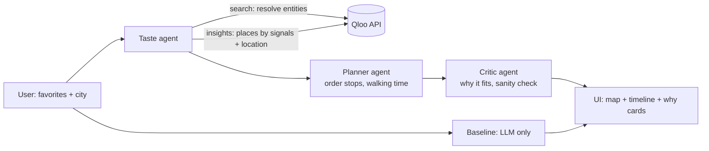

# Architecture



## Data contracts (Pydantic, `src/tastewalk/schemas.py`)
- `UserInput` - city, favorites (name + type)
- `TasteProfile` - resolved Qloo entity IDs, top tags/themes
- `Place` - qloo_id, name, category, lat/lon, tags, affinity score, hours (if available)
- `Itinerary` - ordered stops, start time, per-leg walking minutes, total distance
- `Stop` - place, arrive/leave time, why_it_fits
- `Comparison` - qloo_itinerary, baseline_itinerary

## Planned layout
```
src/tastewalk/
  config.py      # env
  qloo.py        # Qloo client: search, insights, caching
  llm.py         # OpenAI-compatible client
  schemas.py
  taste_agent.py planner.py critic.py baseline.py
  routing.py     # distances, walking time, ordering
  loop.py        # orchestration, yields events
  cli.py
app/
  main.py        # FastAPI + SSE
  static/        # single-page UI (map + timeline)
scripts/
  smoke_test_qloo.py
docs/devpost/
```
